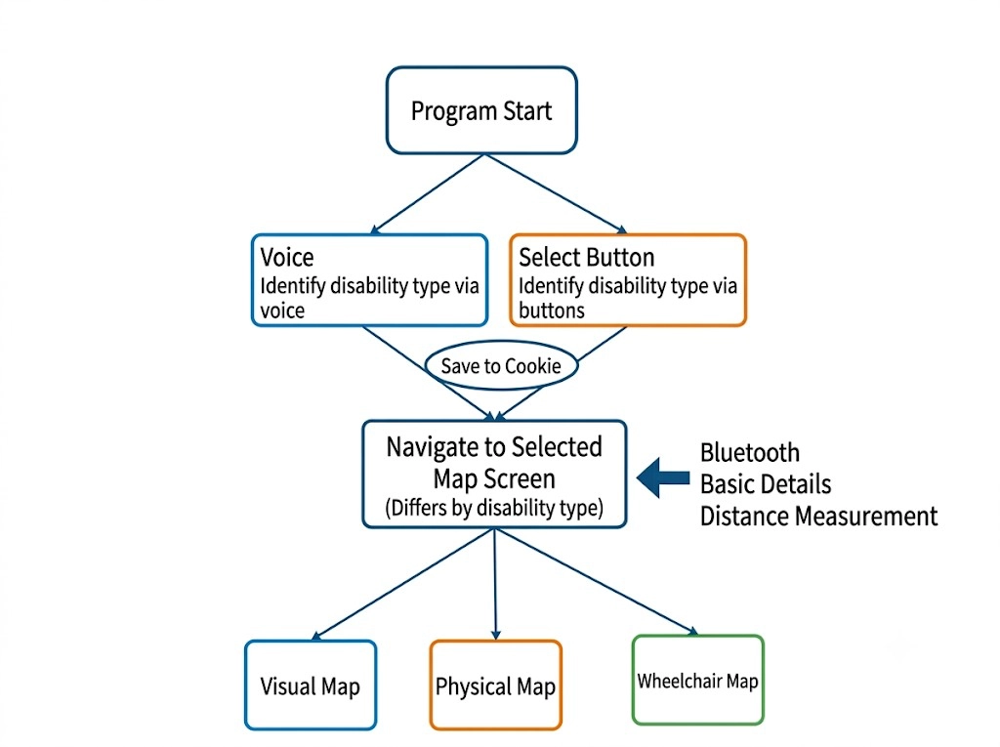
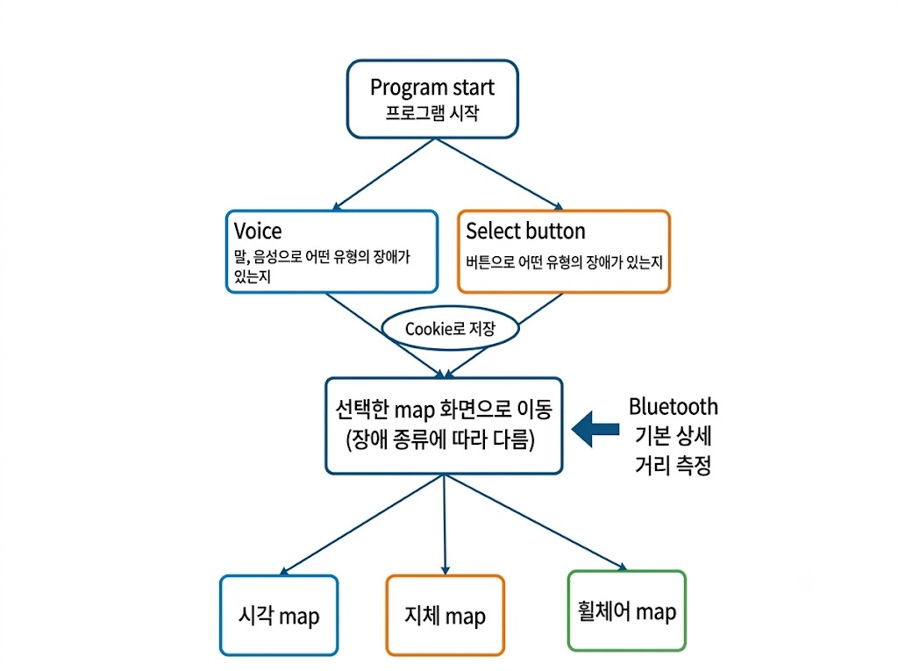

# Map Feature Flow / 지도 기능 흐름

Team flowchart for the map feature (Stage 1: store access).
지도 기능(1단계: 매장 접근)에 대한 팀 흐름도입니다.

| English | 한국어 |
| --- | --- |
|  |  |

## Flow / 흐름

1. **Program start / 프로그램 시작**
2. The user tells the app their disability type, in one of two ways.
   사용자가 장애 유형을 알려 줍니다. 방법은 두 가지입니다.
   - **Voice / 음성:** say it (말, 음성으로 어떤 유형의 장애가 있는지)
   - **Select button / 버튼 선택:** tap a button (버튼으로 어떤 유형의 장애가 있는지)
3. **Save to cookie / Cookie로 저장:** the choice is remembered, so it is
   asked only once. 선택을 저장해 다음부터 다시 묻지 않습니다.
4. **Navigate to the selected map screen / 선택한 map 화면으로 이동.** The
   screen differs by disability type. 장애 종류에 따라 화면이 다릅니다.
   Inputs to this screen / 이 화면에 들어가는 정보:
   - Bluetooth / 블루투스
   - Basic details / 기본 상세 정보
   - Distance measurement / 거리 측정
5. One of three maps / 세 가지 지도 중 하나:

| Map | 지도 | For / 대상 |
| --- | --- | --- |
| Visual Map | 시각 map | Blind and low-vision users / 시각장애인, 저시력 사용자 |
| Physical Map | 지체 map | Users with physical disabilities / 지체장애인 |
| Wheelchair Map | 휠체어 map | Wheelchair users / 휠체어 사용자 |

## Related / 관련 문서

- [project-idea.md](project-idea.md): Worksheet 2 lists the Stage 1 features:
  store accessibility information and GPS/geofencing store recognition
  (both Must, in the MVP). 워크시트 2의 1단계 기능 (Must, MVP 포함).
- The backend already stores what the map needs for each store: `location`
  (lat/lng), `geofenceRadiusM`, `accessibility`, `orderingMethods`,
  `indoorDirections` (`GET /stores`, `GET /stores/{id}`).
  백엔드는 지도에 필요한 매장 정보(좌표, 반경, 접근성 정보 등)를 이미 제공합니다.

## Open questions / 결정할 것

- How do the Physical and Wheelchair maps differ (e.g. stairs and steps vs.
  entrance width, ramps, elevators)?
  지체 map과 휠체어 map의 차이는? (예: 계단·단차 vs 출입구 폭·경사로·엘리베이터)
- What does the Visual map look like for a screen-reader user: a list read
  aloud, or a map with large high-contrast markers for low vision?
  시각 map은 스크린 리더 사용자에게 어떻게 보이나요? (음성으로 읽는 목록 / 저시력용 큰 고대비 지도)
- Can the user change their disability type later (a settings button)?
  사용자가 나중에 장애 유형을 바꿀 수 있나요? (설정 버튼)
- Cookie or `localStorage`? A cookie is sent with every request; `localStorage`
  stays in the browser. Either works if the server doesn't need the value.
  Cookie 또는 localStorage? 서버가 값을 쓸 필요가 없으면 둘 다 됩니다.
