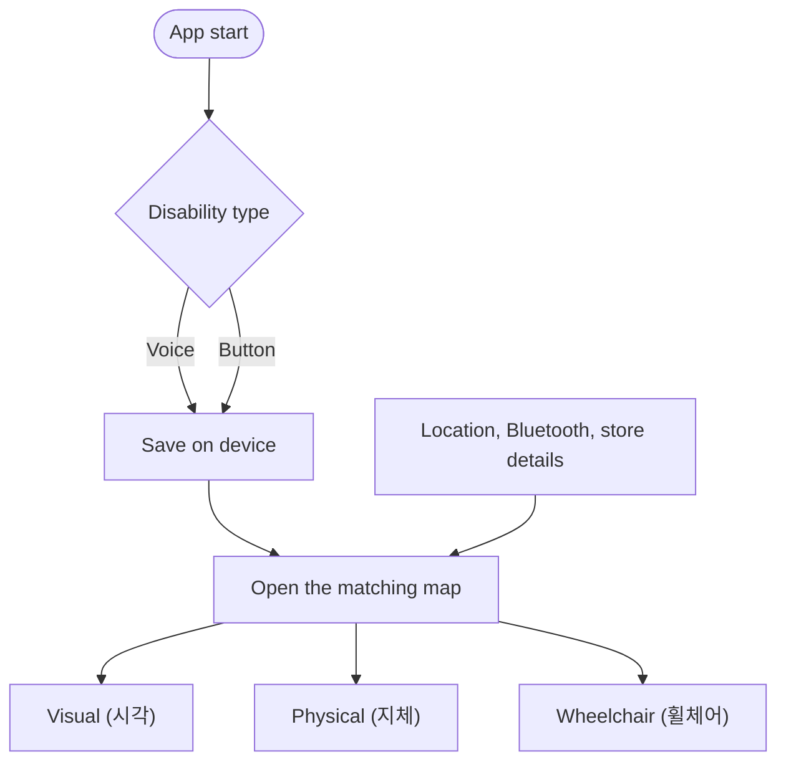

# Map

The map answers the first question of a visit: can I get into this store?
Each disability type gets its own map.

## Flow

The user picks their type once, by voice or button. The choice stays on the
device (cookie or `localStorage`). The server never needs it.

## Modes

Draft. See open questions below.

| Mode | For | Focus |
| --- | --- | --- |
| Visual (시각) | Blind and low-vision users | Stores as a list read by the screen reader, or large high-contrast markers |
| Physical (지체) | People with physical disabilities | Stairs, steps, elevator, floor |
| Wheelchair (휠체어) | Wheelchair users | Step-free entrance, ramp, entrance width. "Can enter" based on the user's max step height |

## Store data

- `GET /stores/nearby?lat=&lng=&radiusM=`: nearest first, with `distanceM`
  and `insideGeofence`.
- `GET /stores/{id}`: `location`, `geofenceRadiusM`, `orderingMethods`,
  `accessibility`, `kioskFeatures`, `indoorDirections`.

`accessibility` holds `floor`, `stepFreeEntrance`, `automaticDoor`,
`elevator`, `accessibleRestroom` and `notes`. Planned: step height, ramp,
entrance width.

Pilot data is entered by hand after visiting the store. To keep it current,
ask "Could you get in?" after each order.

## Map provider

Kakao Maps has the best Korean place data. It needs a Kakao developer app key
with our domain registered. Leaflet with OpenStreetMap works without a key.

## Open questions

- Where exactly do the physical and wheelchair maps differ?
- Visual mode: spoken list, high-contrast map, or both?
- Can the user change their type later, from settings?

## Prior art

[WheelCity](https://github.com/kang022878/WheelCity_back_2025) (2025) is a
crowdsourced barrier-free map for wheelchair users. Entrance photos are tagged
`ramp` / `curb` by YOLOv8 and Gemini, and user reviews keep the data current.
Ideas worth taking: a per-user max step height, richer entrance fields,
review-based updates. Galjido covers more disability types and continues past
the entrance into ordering.

Their repos have no license. Take ideas, not code.
