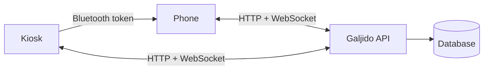

# Overview

Galjido (갈지도) helps blind, low-vision and physically disabled people get
into a store and order there, from their own phone.

## Problem

Accessible kiosks exist. Using them is another matter. In store visits:

- A blind user who uses kiosks daily needed about 5 minutes to add one item.
- Voice guidance cut out or skipped options. The screen magnifier froze the kiosk.
- Low contrast made screens hard to read with low vision.
- Kiosk height and store entrances blocked users with physical disabilities.

Existing services fix one step: an accessibility map, indoor navigation, or a
better kiosk. A real visit goes through all of them.

## Users

- Blind and low-vision people
- People with physical disabilities, including wheelchair users

## How it works

A visit has three stages. Galjido covers each one.

| Stage | Question | Galjido |
| --- | --- | --- |
| Access | Can I get in? | A map for the user's disability type: entrance, steps, elevator, floor. Geofencing tells them when they reach a store. |
| Ordering method | How do I order here? | The store's ordering methods: kiosk, phone, staff. |
| Ordering | Can I actually order? | The phone pairs with the kiosk over Bluetooth. The user orders on their phone, by touch or voice, and the kiosk shows it live. |

## System

| Part | Repo | Stack |
| --- | --- | --- |
| API | this repo | FastAPI, SQLAlchemy, SQLite (PostgreSQL in production), WebSocket |
| Web app | [project-fe](https://github.com/AI4028/project-fe) | HTML, CSS, JS, Web Speech API, Web Bluetooth |
| Beacon | [hardware](hardware.md) | Arduino, ZS-040 Bluetooth module |

Pairing and ordering step by step: [README](../README.md#how-it-works).
Endpoints: [api.md](api.md).
